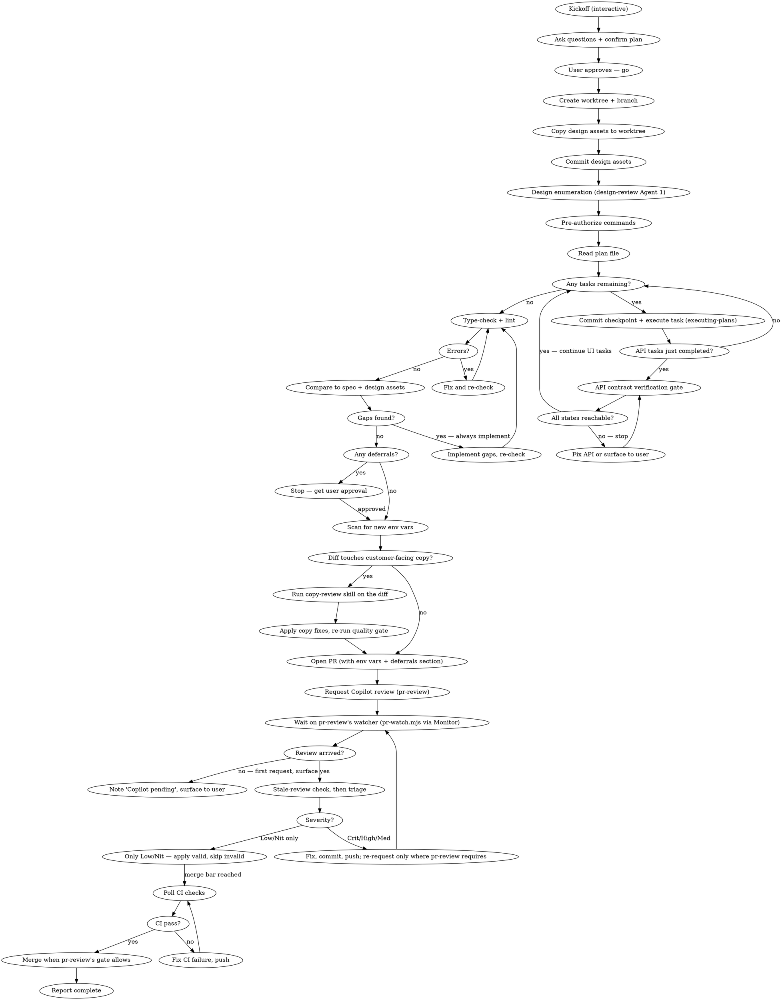

# complete-and-ship

**First, read the project's own rules.** If `.claude/fwd/complete-and-ship.md` exists in the project, read
it before anything else: it names the project's own tools and conventions for this skill, and
its rules add to these and win where they conflict.

## Overview

Start with an interactive kickoff to gather context, ask clarifying questions, and create or confirm the plan. Then bootstrap a feature worktree, copy design assets, complete all outstanding plan tasks, verify implementation against the design spec and design handoff, open a PR, triage GitHub Copilot's automatic review, push, and confirm CI passes.

**The kickoff is interactive — the rest runs unattended.**

## Workflow



---

## Step-by-Step

### Kickoff (Interactive)

This is the only interactive phase. Ask everything you need here so the rest of the run is fully unattended.

#### What to ask

Ask all of these in a **single message** — do not ask one at a time:

1. **Feature / phase** — What is this? (e.g., "Admin UI Redesign")
2. **Branch name** — What should the branch be? (If not given, propose one derived from the feature name, e.g., `feat/admin-ui-redesign`, and confirm)
3. **Design assets** — Path to the design handoff folder relative to the main repo root (e.g., `design/design_handoff_admin_ui/`), or "none"
4. **Plan file** — Does a plan file already exist? If yes, what's the path? If no, describe the scope and you'll create one now

#### After getting answers

1. **If a plan file exists** — read it and summarize outstanding tasks
2. **If no plan file** — use `superpowers:writing-plans` to draft one from the feature description, then show it to the user for approval before continuing
3. **Confirm the full context** in a single message:
   ```
   Branch:       feat/<name>
   Worktree:     <repo>/.worktrees/feat/<name>
   Plan file:    docs/superpowers/plans/<file>.md
   Design assets: design/<folder>/  (or: none)
   Tasks remaining: N
   ```
4. Ask: **"Ready to proceed? I'll run everything else autonomously."**
5. **Wait for the user to say go.** Do not start Step 0 until they confirm.

---

### 0. Worktree and design asset bootstrap

This is the first thing a fresh agent does before any implementation work.

#### 0a. Fetch and sync main

Before creating the worktree, ensure the local `main` branch is current with `origin/main`. The worktree branches from `main`, so a stale local ref means the branch starts behind.

```bash
# The main checkout, wherever this repository lives: the first entry `git worktree list` prints.
MAIN_REPO="$(git worktree list --porcelain | sed -n '1s/^worktree //p')"

git -C "$MAIN_REPO" fetch origin
git -C "$MAIN_REPO" merge --ff-only origin/main
```

If `merge --ff-only` fails (local main has diverged), stop and surface to the user — do not force-reset without confirmation.

#### 0b. Create worktree and feature branch

All feature work runs in an isolated worktree. `$MAIN_REPO` is the one set in 0a. The
worktree location below is a default; use the one the project's extension names, and make
sure it is gitignored.

```bash
BRANCH="<branch-name>"           # e.g. feat/admin-ui-redesign
WORKTREE="$MAIN_REPO/.worktrees/$BRANCH"

git -C "$MAIN_REPO" worktree add "$WORKTREE" -b "$BRANCH"
```

All subsequent operations in this skill run from `$WORKTREE`, not from `$MAIN_REPO`.

#### 0c. Copy design assets to worktree

The handoff must travel with the branch so it is available for the spec comparison in Step 4.
If it is already committed on `main`, the new worktree has it and there is nothing to copy.
If it exists only as untracked files in the main checkout, copy it across.

```bash
# The design asset path is provided in the agent invocation prompt.
ASSETS="<design-asset-path>"     # e.g. design/design_handoff_admin_ui (no trailing slash)

if git -C "$WORKTREE" ls-files --error-unmatch "$ASSETS" >/dev/null 2>&1; then
  echo "handoff already tracked on the branch; skip 0c and 0d"
else
  mkdir -p "$WORKTREE/$ASSETS"
  # Copy the folder's CONTENTS ("/."), so an existing target never gains a nested copy.
  cp -R "$MAIN_REPO/$ASSETS/." "$WORKTREE/$ASSETS/"
fi
```

Rules:

- Preserve the same relative path inside the worktree as in the main repo
- Copy the entire handoff folder, not just individual files
- Do not copy `.env*` files, node_modules, or build artifacts

#### 0d. Commit design assets

```bash
git -C "$WORKTREE" add "$ASSETS"
git -C "$WORKTREE" diff --cached --quiet \
  || git -C "$WORKTREE" commit -m "chore: add design handoff assets for <feature-name>"
```

This commit ensures design assets are part of the PR diff and available for review alongside the implementation. When nothing is staged (the handoff was already tracked), there is nothing to commit and that is fine.

#### 0e. Pre-implementation design enumeration

> **HARD GATE — Step 2 (task execution) must not start until this step is complete.**
>
> Skipping this step means the verify pass in Step 4 must run two agents instead of one (enumerate then verify), and implementation subagents build blind against the design. The property table is how the verify agent catches gaps deterministically — without it, every gap-finding pass is open-ended and misses things. This step takes one agent call. Do it now.

**If design handoff files exist:** invoke the `design-review` skill, running **Agent 1 (enumerate)** on the design files only (do not read implementation files — none exist yet). Save the output as `docs/superpowers/design-tables/<feature>.md` and commit it:

```bash
git add docs/superpowers/design-tables/<feature>.md
git commit -m "docs: design property table for <feature>"
```

This table is the ground truth for implementation. Reference it in the plan and pass it to each execution subagent in Step 2 so they know exactly what to build. The table is also the input to Agent 2 in Step 4 — a pre-populated checklist replaces open-ended discovery.

**If no design handoff:** skip this step.

---

### 1. Pre-authorize commands

**This step behaves differently in a fresh agent vs. an interactive session.**

**Interactive session:** Invoke the `fewer-permission-prompts` skill. It scans the transcript and writes an allowlist to `.claude/settings.json`.

**Fresh agent (no transcript history):** The transcript is empty, so `fewer-permission-prompts` has nothing to scan. Instead, write the known allowlist directly to the worktree's `.claude/settings.local.json` (local, so it is not committed with the feature), merging into any `permissions.allow` list already there:

```json
{
  "permissions": {
    "allow": [
      "Bash(git *)",
      "Bash(pnpm *)",
      "Bash(gh *)",
      "Bash(cp -R *)",
      "Bash(mkdir *)",
      "Bash(cat *)"
    ]
  }
}
```

Create `.claude/` in the worktree if it doesn't exist. Swap `pnpm` for the project's package manager. This allowlist covers all bash operations this skill needs. Add any project-specific tools surfaced during execution.

---

### 2. Complete remaining tasks

Use `superpowers:executing-plans` for each outstanding task. Read the plan file, find every unchecked task, execute them in order.

**Commit after each task.** At every task boundary, stage and commit the work with a conventional commit message before moving to the next task. This preserves state so a fresh session can resume from the last committed checkpoint if this session hits limits. See _Session Continuity_ below.

---

### 2.5 API contract verification gate

> **HARD GATE — applies when the plan includes both API and UI tasks.**
>
> After all API/backend tasks complete (routes, types, DB queries), but before any UI task begins, perform this check. Skip only if the feature is UI-only with no API changes.
>
> This step typically takes 15–30 minutes and prevents hours of debugging later. A state that can't be reached because the API doesn't return the right data is a bug that manifests as a multi-hour session, not a quick fix.

If the design has a state coverage table (in the design README or spec — look for a table with columns like "State", "Trigger", "Visual"), read it now. For every named state:

1. **Identify the triggering condition** — what API field and value causes this state to render?
2. **Type check** — is that field present in the relevant TypeScript response type (for example `UserProfileResponse`)?
3. **Route check** — does the API route that returns this data actually compute and assign that field? (Check for `= null` stubs, missing queries, or code paths where the field is never set.)

Mark each state one of:

- ✅ **Contract verified** — field exists in the type AND the route actually computes it
- ⚠️ **Type present, route incomplete** — the type has the field but the route always returns `null` / never sets it
- ❌ **Not surfaced** — the field is not in the response type at all

**For any state marked ⚠️ or ❌: stop. Do not begin UI tasks.** Either:

- Fix the API route to surface the field (preferred — implement it now, it's usually a small addition)
- Or stop and surface to the user: "State X is not reachable because the API doesn't return [field]. Implement now, or defer with your explicit approval?"

**Do not assume UI states will "just work" later.** A UI component that renders correctly when given the right props but is never given those props is indistinguishable from a working implementation until someone tries the state manually. Catch it here.

---

### 3. Quality gate

Run typecheck and lint (plus a format check where the project has one) for every app touched by
the plan, using the project's own commands (the form below is a pnpm workspace; the extension
names others):

```bash
pnpm --filter <app> typecheck
pnpm --filter <app> lint
```

Do not run tests or a production build locally: CI is the only test gate (pr-review §5). Write
the tests with the code and let CI run them. Fix any errors before continuing. Do not proceed to
the spec comparison with type or lint errors.

---

### 4. Compare implementation to design spec and design assets

> **ABSOLUTE HARD GATE — `gh pr create` must not run until this step is finished.**
>
> This is the most commonly skipped step and the most important one. The agent completed implementation tasks and opened the PR without doing this check — that is a process violation. Steps 5 and 6 do not start until Step 4 produces a written gap list, all gaps are implemented or explicitly deferred, and the gap report is committed to the branch.
>
> **You must produce a written gap report (4d) and commit it before you are allowed to open the PR. No exceptions.**

#### 4a. Feature acceptance, then design-review

**Invoke `feature-acceptance` first.** A design-review compares files to a
handoff; it does not tell you whether the route renders at all. Produce that
skill's artifacts for every route × viewport this PR touches — the contact sheet,
marker presence, import equality against any route the brief says this one matches
— and attach the contact sheet to the PR. Then run design-review below.

#### 4a-ii. Use design-review skill for UI verification

**If a design handoff exists** (design files were copied in Step 0): invoke the `design-review` skill.

- If Step 0e ran and a property table exists at `docs/superpowers/design-tables/<feature>.md`, run `design-review` **Agent 2** (verify) using that table + implementation files. This is one deterministic pass, not open-ended discovery.
- If no property table exists (design-review was not run pre-implementation), run `design-review` **Agent 1** (enumerate) first, then **Agent 2** (verify) second.
- Fix ALL gaps found by Agent 2 at once. Run the quality gate again. Then run `design-review` **Agent 3** (confirm) on the gap list only.
- If Agent 3 still finds gaps, fix them and re-run Agent 3 **once more**, on those items only. If that re-run still finds gaps, stop iterating: list them in the gap report and report them to the user.
- Proceed to 4b only after Agent 3 returns 0 gaps, or the user accepts the listed remainder.

**Total agent calls for UI verification: four at most (one bounded Agent 3 re-run), never 10+.**

**If no design handoff exists:** proceed directly to 4b (written spec verification).

#### 4b. Identify written spec reference materials

Check these sources for non-UI requirements (API contracts, data shapes, states, non-functional requirements):

1. **Written spec** — check in order:
   - The plan file's header for a spec reference
   - `CLAUDE.md` for a linked spec under the current phase
   - `docs/superpowers/specs/` for the most-recently-modified spec matching the feature

#### 4c. Enumerate and verify non-UI spec requirements

Read the spec top-to-bottom and list every named requirement, API contract, interaction, state (loading/empty/error), and non-functional requirement that was not covered by the design-review property table. For each item, check source files, routes, components, and tests — mark it as implemented or gap.

#### 4d. Produce and commit a gap report

Write a gap report file at `docs/superpowers/gap-report-<feature>.md` in the worktree. Format:

```markdown
# Gap Report — <Feature Name>

## IMPLEMENTED (N)

- ComponentName — requirement satisfied [file:line]
- ...

## GAPS (N)

- ComponentName — what's missing/wrong [file:line]
- ...

## DEFERRED (N)

- ItemName — reason: <explicit reason>
```

**Commit this file before doing anything else:**

```bash
git add docs/superpowers/gap-report-<feature>.md
git commit -m "docs: design gap report for <feature>"
```

This commit is the gate. If this file is not committed, the PR is not open. No exceptions.

After committing the gap report, implement every non-deferred gap. Return to Step 3 after adding gap implementations. When all gaps are resolved, update the gap report to show all items as IMPLEMENTED and commit the update.

#### 4e. Deferral policy

**Deferrals are never unilateral. They always require explicit user approval.**

A spec/design item may only be deferred if one of these is true:

- It requires a product decision, credential, or third-party integration that genuinely cannot proceed without human input
- The spec explicitly marks it as a future phase AND the item is fully self-contained (no other implemented feature depends on it being done)

"Hard" is not a valid reason. "Time-consuming" is not a valid reason. When in doubt, implement it.

**How to handle a potential deferral:**

1. **Stop before opening the PR**
2. **Surface it explicitly to the user** in a message: "I need to defer [item] because [specific, objective reason]. This affects [which states/UI surfaces won't work]. Can I proceed?"
3. **Wait for the user's explicit approval.** Do not open the PR, do not continue, until you have it.
4. **After approval**, list every deferred item in the PR body under a **Deferred** section with the explicit reason and user approval. It must be visible in the PR itself, not only in a gap report file.

A deferred item that the user discovers for the first time by opening a gap report is a process failure. They must know about it before the PR exists.

---

### 5. Scan for new environment variables

> **Pre-flight check:** Before continuing, confirm Step 4 is fully complete — every gap either implemented or explicitly deferred with a written reason. If Step 4 is not done, stop and finish it before opening the PR.

Before writing the PR body, detect any new env vars introduced by this branch:

```bash
# New .env.example lines vs main
git diff main...HEAD -- '*.env.example' | grep '^+' | grep -v '^+++'

# New process.env references in source
git diff main...HEAD -- '*.ts' '*.tsx' | grep '^+' | grep 'process\.env\.'
```

For each new variable, collect:

- **Name** — the exact env var key
- **Purpose** — one-line description of what it controls
- **Service** — which deployed service or services need it, as named in the project's hosting config (e.g. `render.yaml`, `vercel.json`)
- **Environment** — `staging`, `production`, or both
- **GitHub secret** — yes/no (needed for CI/CD workflows or smoke tests)
- **How to provision** — where to get the value (dashboard, CLI, generate a random secret, etc.)

This list feeds directly into the PR body.

---

### 5b. Copy review gate (before the PR opens)

If the branch touches any customer-facing copy, run the **`copy-review`** skill over the diff and apply its findings _before_ `gh pr create`. Copy that ships is copy that has to be re-audited later; a full-codebase copy audit finds, almost entirely, strings that entered exactly this way.

The copy inventory (which files hold customer-facing strings) and the frozen areas are named in
`copy-review`'s project binding, `.claude/fwd/copy-review.md`. The gate triggers when
`git diff main...HEAD --name-only` includes any of:

- a file in that copy inventory (copy definitions, release notes or changelog entries)
- an email template or push-notification template
- a design handoff containing copy
- any new user-visible string added inline in a component file

```bash
# COPY_PATHS: the inventory's path patterns from .claude/fwd/copy-review.md, as one anchored ERE.
# Example only:
COPY_PATHS='(^|/)definitions/copy\.ts$|(^|/)emails?/|(^|/)notifications/push/|(^|/)design_handoff_[^/]+/'
git diff main...HEAD --name-only | grep -E "$COPY_PATHS"
```

Anchor the patterns on path segments: a bare `email` or `push` matches unrelated files such as
`emailValidator.ts` or `pushState.ts`, and a gate that fires on everything gets ignored.

**Inline strings: check for a mechanical backstop before relying on one.** If the project's lint
config enables a rule that forbids inline literals (such as `react/jsx-no-literals`), a clean
lint covers JSX text, and only JSX text. The lint config itself is the one place to check:
grep it directly (an extension may note the answer, but the config wins). Either way, read the
diff for user-visible strings the rule cannot see: arguments to functions such as
`toast.error(...)`, strings assigned to variables or constants, and error messages that reach
the screen. Without such a rule, read the diff for every new user-visible literal by hand.

No match and no inline strings → skip to Step 6 and say so. Match → run `copy-review`, fix what it flags, re-run the quality gate, then open the PR.

The binding's **frozen areas** (for example, release-note entries that already shipped, or
strings a design lock or a test pins) are not yours to rewrite and not `copy-review`'s either.
Flag drift there to the user instead of editing it.

---

### 6. Open PR

Publish the branch first: the bootstrap created it locally, and `gh pr create` prompts or
aborts without a remote head in an unattended run. `git push -u origin HEAD`, after the pre-PR
gates have passed.

If the project has a PR template (`.github/pull_request_template.md` or a file under
`.github/PULL_REQUEST_TEMPLATE/`), use it as the base and fold the sections below into it.
If it has none, use the sections below as they are. Fill in all sections:

If you write the body to a file, name it after the PR or branch (`<branch>-body.md`), never a
generic `pr-body.md`, because subagents in one session share one scratchpad; read it back before
any `--body-file` and check it is this PR's body.

```bash
gh pr create \
  --title "<conventional-commit-style title>" \
  --body "$(cat <<'EOF'
## Summary
- <bullet 1>
- <bullet 2>

## Test plan
- [ ] Type-check passes
- [ ] Lint passes
- [ ] CI passes (tests run in CI only)
- [ ] Manual smoke: <what to click/verify>

## Spec coverage
- All spec and design requirements implemented
<!-- OR list deferred items with explicit reason: -->
<!-- - `FeatureName` — deferred: requires a third-party credential (payment webhook secret) -->

## New environment variables
<!-- Omit this section if no new env vars -->
| Variable | Purpose | Service | Environment | GH Secret | How to provision |
|----------|---------|---------|-------------|-----------|-----------------|
| `VAR_NAME` | What it does | <service> | staging + prod | No | Generate with `openssl rand -hex 32` |

EOF
)"
```

Follow the project's convention on AI attribution in PR bodies (the extension names it).

---

### 7. Request Copilot review (iterative)

**Invoke the `pr-review` skill and follow it.** It owns the request mechanics
(REST body, the silent-200, timeline verification), the wait (its watcher,
`pr-watch.mjs`, armed once via `Monitor` when the PR opens and left running across
re-requests), the mandatory stale-review check before triage, what counts as a
finding, when a fix earns a re-request, the convergence rules, and the merge bar.
Do not run this step from memory, and do not hand-roll a polling loop.

Two things this skill adds on top:

- If the watcher reports no review on the **first** request within pr-review's
  waiting window, leave a PR comment — "Copilot review pending — will triage when
  it arrives." — and surface to the user before pushing further commits. Do not
  merge without a successful review.
- Each fix round is Step 8 below. Come back here to re-request only when pr-review
  says the fix earns one (a Critical/High/Medium fix in production code); other
  fixes are pushed and ride to the merge.

---

### 8. Triage all comments

Triage per the `pr-review` skill — severity table, the nit/sweep rules, the
CI-only mutation check on a fix that ships with a test, and the `## Settled`
push-back section in the PR body. The convergence rule that matters most here:
**three consecutive rounds of findings on the same function or component means
the next action is a scope decision, not another fix.**

Severity signals:

- Critical/High: "bug", "error", "security", "breaks", "incorrect", "unsafe", "missing validation", "race condition"
- Medium: "should", "missing", "consider adding", "incomplete", "unclear", "inconsistent"
- Low/Nit: "prefer", "nit", "optional", "consider", "minor", "style"

When in doubt, treat as Medium (fix it).

---

### 9. Rebase and push

Before pushing, ensure the branch is rebased on top of the latest `origin/main` to keep a linear history and avoid stale-base conflicts:

```bash
git fetch origin
git rebase origin/main
```

If conflicts arise during rebase, resolve them file by file, then continue:

```bash
# For each conflicted file:
# 1. Open the file and resolve conflict markers (<<<<, ====, >>>>)
# 2. Stage the resolved file
git add <conflicted-file>
# After all conflicts resolved:
git rebase --continue
```

If the rebase becomes too complex to resolve safely, stop and surface to the user — do not `git rebase --abort` without informing them.

Once the rebase is clean:

```bash
git push                          # if rebase was a no-op (output: "Current branch ... is up to date.")
git push --force-with-lease       # if rebase actually rewrote commits (output: "Rebasing (1/N)…(N/N) Successfully rebased and updated")
```

Only force-push when the rebase ACTUALLY rewrote commits. Reflexively pairing rebase with force-push is noise on the remote, obscures real history changes, and trains a habit that erodes the gravity of force-pushing. `--force-with-lease` (not `--force`) when needed — the push is then rejected if someone else has pushed to the same remote branch since you last fetched, preventing accidental overwrites.

---

### 10. CI gate and merge

After pushing, monitor CI checks until they pass or fail (pr-review's watcher also reports each
head's CI as it completes):

```bash
gh pr checks <PR_NUMBER> --watch
```

If any check fails:

1. Read the failure output: `gh run view <RUN_ID> --log-failed`
2. Fix the root cause in source
3. Re-run the local quality gate (Step 3); the test itself is confirmed by CI, not locally
4. Commit and push
5. Return to the top of Step 10 and re-watch

If a CI failure is environment-specific (missing secret in CI, flaky network test) and cannot be fixed in code, surface it to the user with the specific error and run ID — do not loop endlessly.

**Merge.** Once CI is green on the head and pr-review's merge bar is met, merge the PR yourself
as pr-review §8 directs: run its gate with `--action merge`, merge in its own command after the
checks finish, and use no auto-merge flags. Do not park a green PR on a confirmation, and do
not fix one more thing first. This step is the orchestrator's: a dispatched subagent stops at the end of Step 7 (see "When
invoked as a subagent") and never reaches it. The only other exception: the project's
extension or the user reserves merging for a human, in which case stop before merging and say
so in the report.

---

### 11. Report

Output a summary:

- Tasks completed
- Spec and design gaps found and implemented (or confirmed none)
- Spec items deferred (with reasons)
- New env vars (with provisioning table)
- PR URL
- CI status (pass / failure details)
- Merge status (merged, with the merge SHA, or why it was not merged)
- Review comments received (count by severity)
- Any low/nit notes left on the PR
- Any fixes made inline

---

## Invocation

To start, just invoke the skill and provide the minimum context. The Kickoff phase will ask for anything else it needs.

**Minimum invocation:**

```
/complete-and-ship

Feature: Admin UI Redesign
Design assets: design/design_handoff_admin_ui/
```

That's it. The skill will:

1. Ask any clarifying questions (branch name, plan file, scope) in a single message
2. Draft or read the plan and show it to you
3. Wait for your "go" before starting autonomous execution

**If no design handoff exists:**

```
/complete-and-ship

Feature: <description>
Design assets: none
```

**If a plan file already exists:**

```
/complete-and-ship

Feature: <description>
Design assets: design/<folder>/
Plan file: docs/superpowers/plans/<file>.md
```

Providing the plan file skips the planning step and goes straight to confirming outstanding tasks.

---

## Session Continuity

Claude sessions can end unexpectedly due to token limits, turn limits, or context compaction. This skill is designed to survive interruption.

### How to preserve state

At every task boundary (end of Step 2 iterations, after gap implementations, after Copilot fixes):

1. **Commit work in progress** — even partial progress is better than lost work
2. **Mark completed tasks** in the plan file (check off boxes) before committing
3. **Note current step** in a `## Resume` section at the bottom of the plan file if mid-flow

The plan file is the resume token. A fresh session invoking `/complete-and-ship` should:

- Read the plan file first to find the last completed step and any `## Resume` note
- Detect the open PR if one exists: `gh pr list --head $(git branch --show-current) --json number,url`
- Resume from the correct step rather than restarting

### Recovery entry points by step

| If interrupted after...             | Resume at                                                                  |
| ----------------------------------- | -------------------------------------------------------------------------- |
| Step 0 (worktree/assets)            | Check worktree exists; check design assets committed; re-run missing parts |
| Step 2 (some tasks done)            | Re-read plan, execute remaining unchecked tasks                            |
| Step 3–4 (quality gate / spec work) | Re-run quality gate, re-verify spec and design assets                      |
| Step 5–6 (env scan / PR open)       | Check if PR exists (`gh pr list`); create if not, skip if already open     |
| Step 7 (Copilot review requested)   | Re-arm pr-review's watcher; run the stale-review check on any review there |
| Step 8–9 (fixes pushed)             | Run pr-review's gate; resume any owed re-request, wait or triage, then 10  |
| Step 10 (watching CI)               | Re-run `gh pr checks --watch`; merge if the bar and CI are green           |

### On hitting a turn limit mid-task

If you sense the session is running long (many turns, repeated compaction warnings), prioritize:

1. Commit whatever is done
2. Update the plan file checkboxes to reflect true state
3. Note the exact next action in a `## Resume` section of the plan file
4. Surface a one-line status to the user: "Session at limit — committed through [step]. Resume with `/complete-and-ship`."

---

## When invoked as a subagent (Agent tool dispatch)

If this skill is being executed inside a subagent dispatched via the `Agent` tool — not the user's own session — **stop at the end of Step 7 (first Copilot review requested) and return**. Steps 8–10 (triage, push, CI watch, merge) are the orchestrator's job, not yours.

The subagent runtime budget (Monitor TTL, turn cap, wall-clock) is bounded; the multi-round Copilot review cycle is not. Front-load the work that's bounded, hand off the work that isn't.

### Return contract

When you stop, your final message must contain — in this order — exactly these four things, nothing else:

1. **PR URL** — `https://github.com/<org>/<repo>/pull/<N>`
2. **Branch name** — `feat/<...>` or `fix/<...>`
3. **State summary** (one short line per item):
   - CI status: `green` / `running` / `failed: <check>`
   - First Copilot review: `review requested (verified on timeline)`
   - Open ends: env vars to provision, deferrals approved, follow-up issues opened — and for any follow-up needing **Design** input, confirm a row was added on this branch to the design pipeline tracker that `design-status` reads. `design-status` parses that file and never queries issue labels, so a design-labelled ticket with no tracker row is invisible to the pipeline. Judge by the fix, not the label: a missing affordance, a placement call or a new surface is design work even when filed as a bug or a polish ticket
4. **Branch SHA at hand-off** — short SHA from `git rev-parse --short HEAD`

The orchestrator reads this and picks up at Step 8. Do not poll Copilot beyond the first request — if you do, you will be killed mid-poll and leave the orchestrator with no record of what state you reached.

### Don'ts

- Don't use the `Monitor` tool to wait for Copilot reviews. Its TTL is shorter than the typical multi-round cycle.
- Don't loop on `ScheduleWakeup` to self-pace the wait — subagents don't survive across wake-ups; only the user's session does.
- Don't address Copilot findings yourself. Return after the first request; the orchestrator triages from there.

### Don't apply this section when

- You ARE the user's session (not a dispatched subagent). Run the full cycle through Step 11.
- The plan explicitly tells you to handle the full Copilot cycle inline (e.g., a small fix where the orchestrator wants the subagent to finish-to-merge-ready before reporting). Defer to the prompt.

---

## Autonomous Operation

This skill is designed to run unattended. **Do not pause to ask permission for routine operations.**

Proceed without confirmation for:

- Reading any file in the repo or worktree
- Editing source files, config files, CSS, tests
- Running `pnpm`, `tsc`, `eslint`, `git add/commit/push` (never a local test run; pr-review §5)
- Running `gh pr create`, `gh pr edit`, `gh pr view`, `gh pr checks`, `gh run view`
- Merging the PR once pr-review's gate allows it (Step 10)
- Creating or updating files that are part of the plan
- Copying design assets from main repo to worktree (`cp -r`)
- All `superpowers:*` skill invocations and their sub-operations (TaskCreate, TaskUpdate, Agent dispatches, file reads/writes, bash commands within executing-plans)
- Writing the pre-authorized allowlist to `.claude/settings.local.json`

**Never, under any circumstances:**

- Read, log, print, or commit secrets, API keys, or PII
- Include `.env.local` or any non-`.example` env file in commits or PR descriptions
- Echo environment variable values into output or PR comments

**Stop and surface to the human only when:**

- A task instruction is genuinely ambiguous and proceeding would require guessing at intent
- A quality gate fails and the root cause is unclear after one honest attempt to fix it
- A Copilot comment is categorized Critical/High but the correct fix is non-obvious
- Any action would be destructive or irreversible outside the repo (e.g., production DB migrations, force-push to main)
- A spec or design requirement cannot be implemented without a decision, credential, or third-party integration
- A CI failure is environment-specific and cannot be fixed in code
- The session is approaching its limit — save state and surface status before stopping

If in doubt about whether to ask: if it's in the repo and reversible via git, proceed.

---

## Rules

- **Never skip Step 0** — worktree isolation and committed design assets are required.
- **Never skip the quality gate** — type errors block the PR.
- **Never use `--no-verify`** — pre-commit hooks must pass.
- **Never skip the spec and design comparison** — both are authoritative; either can reveal gaps. The gap report file must be committed before `gh pr create` runs — this is the physical proof the step was done.
- **Never open a PR before Step 4 is fully complete** — this means the gap report is written, committed, all gaps resolved or explicitly deferred, and the gap report updated to reflect final status. No exceptions. "I checked it in my head" is not acceptable.
- **Never defer without user approval** — surface every deferral before opening the PR; wait for explicit approval; list it in the PR body. Burying a deferral in a gap report file is not acceptable.
- **Never begin UI tasks when the API contract is incomplete** — if a state in the design's coverage table has no triggering condition surfaced in the API response, fix it before writing UI code. See Step 2.5.
- **Merge when pr-review's gate allows, not before and not after** — once the merge bar and CI are green, merge yourself (Step 10), unless the extension or the user reserves merging for a human. Never with auto-merge flags.
- **Fix every valid Copilot finding, nits included.** Re-request only where `pr-review` says the fix earns a round (a Critical/High/Medium fix in production code). The `pr-review` skill owns the bar, the stale-review check, and when to stop.
- **Document every new env var** — missing env vars block staging deploys.
- **Confirm CI is green before reporting complete** — a passing local quality gate is not the same as passing CI.
- **If a critical fix introduces new errors**, fix those too before pushing.
- **If no review arrives on the FIRST request** within pr-review's waiting window, leave a "Copilot review pending — will triage when it arrives" PR comment and SURFACE TO THE USER. Do NOT proceed to merge without successful reviews. If Copilot errors 3+ consecutive times spaced over hours, pause and ask the user for direction — never invent an "errored-out fallback" merge.
- **Commit at every task boundary** — session continuity depends on frequent commits.

---

## Required Sub-Skills

- **`fewer-permission-prompts`** — invoked at Step 1 (interactive); bypassed with a hardcoded allowlist in fresh-agent context.
- **`superpowers:executing-plans`** — used for each remaining task in Step 2.
- **`copy-review`** — invoked at Step 5b whenever the diff touches customer-facing copy, before `gh pr create`.
- **`design-review`** — Agent 1 at Step 0e; Agents 2–3 at Step 4a-ii.
- **`feature-acceptance`** — at Step 4a, before design-review.
- **`pr-review`** — owns Steps 7–8 and the merge bar in Step 10 (request, watcher, stale-review check, triage, re-request rules, merge).

---

## Common Mistakes

| Mistake                                                    | Fix                                                                                                                             |
| ---------------------------------------------------------- | ------------------------------------------------------------------------------------------------------------------------------- |
| Skipping Step 0 because "worktree is already set up"       | Always verify; if truly done, confirm assets are committed                                                                      |
| Forgetting to commit design assets                         | They must be on the branch so reviewers see them alongside the implementation                                                   |
| Using main repo path instead of worktree path after Step 0 | All work after Step 0 runs inside `$WORKTREE`                                                                                   |
| Running fewer-permission-prompts in fresh-agent context    | Write hardcoded allowlist directly; transcript is empty                                                                         |
| Opening PR before all tasks complete                       | Always check plan file for unchecked tasks first                                                                                |
| Opening PR before Step 4 is finished                       | The gap report file must be committed to the branch before `gh pr create` runs — no gap report = no PR                          |
| Skipping type-check because "it's just CSS"                | Run the quality gate regardless                                                                                                 |
| Opening a PR that adds copy without running `copy-review`  | Step 5b is a gate, not a suggestion — copy that ships un-reviewed becomes an audit finding later                                |
| Letting `copy-review` rewrite the binding's frozen areas   | They are frozen; flag the drift to the user instead of editing                                                                  |
| Skipping spec or design comparison                         | Both sources are authoritative — produce and commit a written gap report; checking in your head is not sufficient               |
| Assuming Copilot auto-reviews on PR open                   | It does not. Request explicitly and verify on the issue timeline — see `pr-review`                                              |
| Treating Copilot review as a one-shot gate                 | Re-request after each Critical/High/Medium fix in production code, as pr-review says; CI-green is not a substitute for a review |
| Reflexively force-pushing after every rebase               | Use plain `git push` if rebase was a no-op; `--force-with-lease` only when commits were actually rewritten                      |
| Iterating Copilot review until "0 comments"                | Stop at the Low/Nit floor. And triage nothing until the stale-review check passes — see `pr-review` §3                          |
| Deferring a gap without user approval                      | Deferrals require explicit approval before the PR is opened; "I noted it in the gap report" is not enough                       |
| Deferring a gap because it's hard                          | Hard is not a valid reason; implement it or surface to user                                                                     |
| Starting UI tasks when API contract is incomplete          | Run Step 2.5 after API tasks; a UI state whose trigger the API never returns is a latent multi-hour debugging session           |
| Treating "consider" as Critical                            | Read the word choice — "consider" = Low/Nit at most                                                                             |
| Treating "should" or "missing" as Low                      | These are Medium — fix them                                                                                                     |
| Omitting new env vars from PR body                         | Scan every time; missing vars break staging                                                                                     |
| Pushing with lint errors                                   | Fix them; never bypass pre-commit hooks                                                                                         |
| Leaving medium Copilot feedback unaddressed                | Medium = fix inline, same as High                                                                                               |
| Reporting complete before CI is green                      | Always run `gh pr checks --watch` after push                                                                                    |
| Parking a green PR for a human to merge                    | When the bar and CI are green, merge it yourself (Step 10) unless the project or the user reserves merging                      |
| Losing progress when session hits limit                    | Commit at every task boundary; update plan file checkboxes                                                                      |
